# mulebox

Send your AI coding agents' builds and tests to the Linux machines on your network.

Agents (Claude Code, Codex, and others) edit code on your dev machine. Builds, type checks, linting
and test suites are slow, hot and noisy, and several agents running them at once can freeze the
dev machine. With mulebox, an agent types `mulebox check` instead. The job waits its turn in **one
line** shared by every project and agent, runs on a Linux node, and the agent gets the
output and the exit code as if the command had run locally.

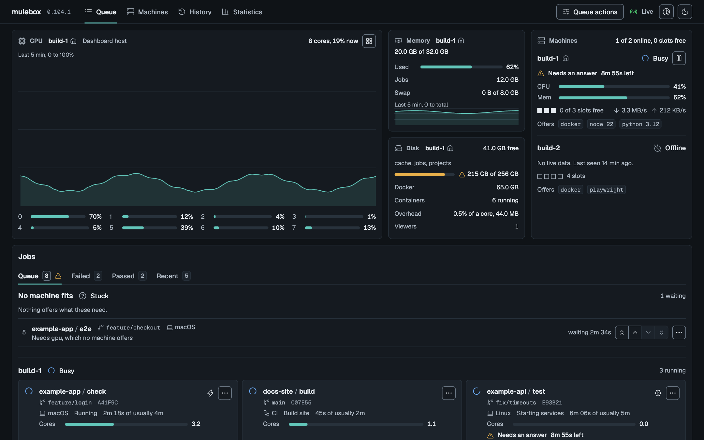

Status: **1.x, in daily use on a real node** (version in [VERSION](VERSION)). The
commands, `.mulebox.yml` and the config files are stable: a change that breaks them needs 2.0.
What is open is in the [roadmap](docs/phases.md).

## Install

You need a Linux machine with systemd, git and Python 3.12 or newer, which your dev machine reaches
over ssh with a key, at an address that does not change (below).

### Give every machine a fixed address

mulebox remembers where each node is: the dev machine keeps the address you set it up with,
a second machine keeps its coordinator's address in its own config, and the dashboard on the LAN
is opened at it. Most routers hand out addresses by DHCP, and a machine can get a new one after a
reboot, a lost Wi-Fi connection or a router restart. Then the dev machine cannot reach it (exit 3),
other machines show offline, and nothing runs until the address is fixed. mulebox does not work
with an address that changes.

Before `mulebox setup`, make each machine's address permanent, in one of these ways:

- **Reserve it on your router** (called a DHCP reservation, static lease or fixed IP): pick the
  machine by its MAC address and give it an address. Nothing changes on the machine itself.
- **Set a static address on the machine**, outside the range the router hands out.
- **Use a name that always finds the machine**, if every machine and the dev machine can resolve it,
  such as a VPN that keeps each device's address.

Check after a reboot of the machine that `ssh <node> true` still works. If an address did change,
put the new one in `~/.ssh/config` (or in `coordinator` in the dev machine's `client.toml`), and on every
other machine in `coordinator` in `node.toml`, then `systemctl --user restart mulebox-worker` there.

### Let your coding agent install it

Give your agent (Claude Code, Codex, or another) this prompt, with your node's ssh name:

```text
Install mulebox for me and set up this project to use it. Read
https://raw.githubusercontent.com/typerhack/mulebox/main/docs/getting-started.md and follow it
in order. My node is <node> (I reach it with `ssh <node>`). Ask me, in one message, only
for the steps that need a password or sudo, then finish the rest yourself and show me a passing
`mulebox check`.
```

The page is written for this: it says which steps need you (copying an ssh key, installing
`python3-venv` with sudo) and which the agent can do alone.

### Or by hand

On the dev machine:

```sh
uv tool install mulebox        # or, with Python 3.12 or newer: pipx install mulebox
mulebox setup <node>           # installs mulebox on your node, then runs a first job
```

mulebox is on [PyPI](https://pypi.org/project/mulebox/). uv brings its own Python, so the dev machine
needs none; to get uv: `brew install uv`, or `curl -LsSf https://astral.sh/uv/install.sh | sh`.

`<node>` is your node as you reach it with ssh, named as you like: a name from your
`~/.ssh/config`, such as `mulebox setup homelab`, or `user@address`, such as
`mulebox setup alice@192.168.1.50`. The dashboard shows the machine under its own hostname.

Then, in any project:

```sh
mulebox init                   # writes .mulebox.yml from the project's own files
mulebox check                  # runs the project's checks on the node
mulebox dashboard open         # the dashboard in your browser, through an ssh tunnel
```

To upgrade later: `uv tool upgrade mulebox` (or `pipx upgrade mulebox`), then
`mulebox setup <node>`. From a clone, and the details: [install.md](docs/install.md#2-install-on-the-dev-machine). The whole
path from nothing to a passing project, in order: [getting-started.md](docs/getting-started.md).

## How it works

Two kinds of machine:

- the **dev machine**: where you and your agents edit code: a laptop, a desktop or another Linux PC. It runs only the
  `mulebox` command, which talks to the nodes over ssh.
- **nodes**: the Linux machines that run the jobs. Each runs a
  **worker**, which runs jobs. One node is also the **coordinator**: it holds the line of jobs
  and their history, and serves the dashboard.

<p align="center">
<picture>
  <source media="(prefers-color-scheme: dark)" srcset="docs/images/architecture-dark.svg">
  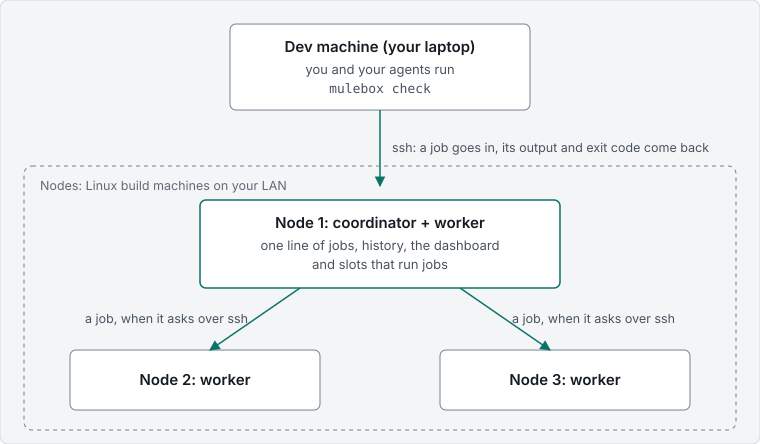
</picture>
</p>

- The dev machine only ever talks to the coordinator. It does not know how many nodes there are,
  so adding one changes nothing for agents or projects.
- Workers ask the coordinator for work. A job goes to the first node with a free slot that has
  what the job needs (Docker, Playwright, a toolchain). A worker reaches the coordinator with a
  key that can do nothing but worker requests.
- The dashboard runs only on the coordinator. Workers send their CPU, memory and network readings
  with every heartbeat, so one page shows every node.
- One node is enough to start: it is both coordinator and worker. A second joins with
  `mulebox setup <second-node> --worker-of <first-node>`. A node can be drained, resumed and removed
  (`mulebox machine`). More than one node has been tried with a stand-in container only, so far.

## The dashboard

Live, in the browser: the line of jobs with each machine's lane, every job's stages and log as
they happen, and controls to pause, freeze, boost, reorder or cancel. It has a dark and a light
theme and follows the system's by default.

| | |
| --- | --- |
| 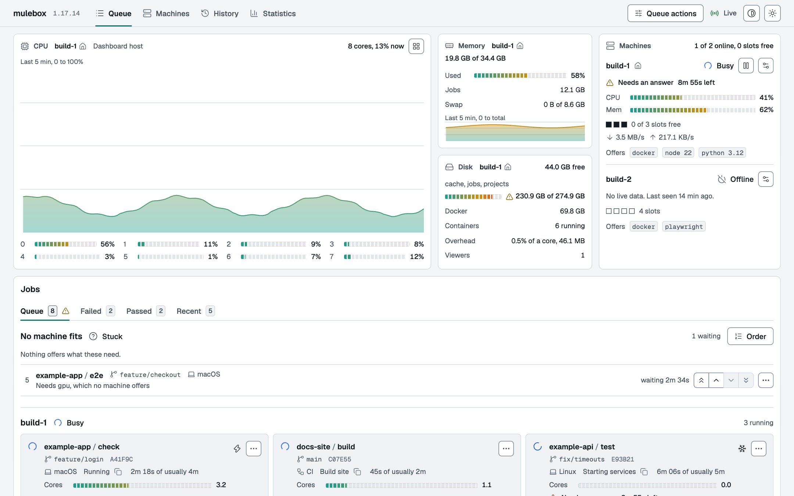 | 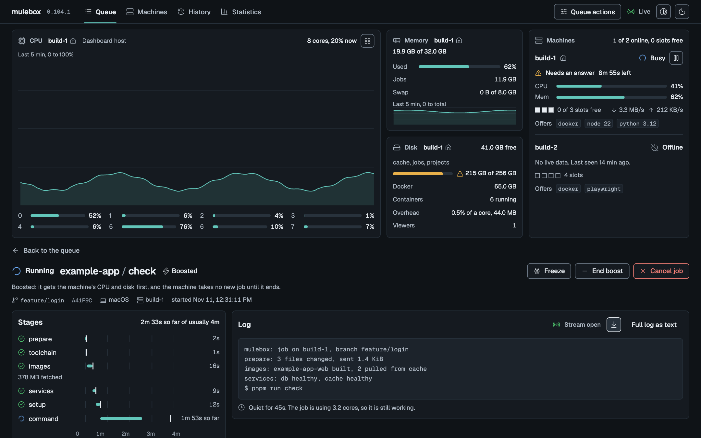 |
| The queue, light theme | A running job: stages and live log |
| 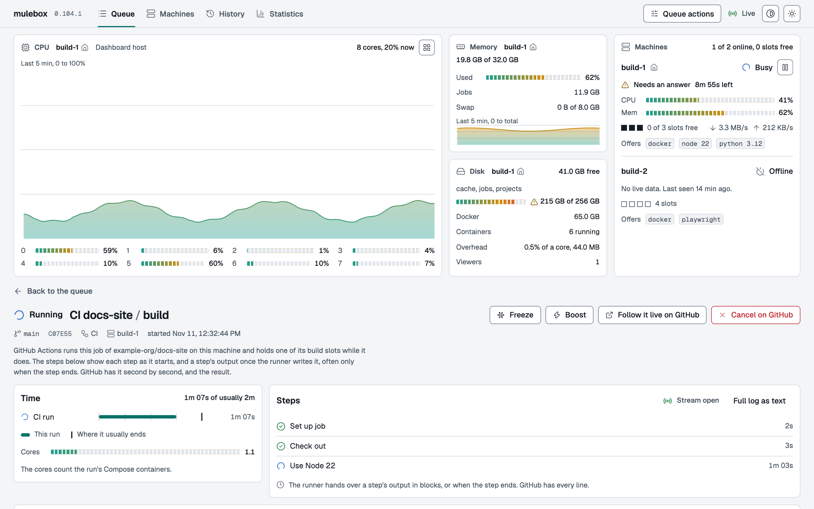 | 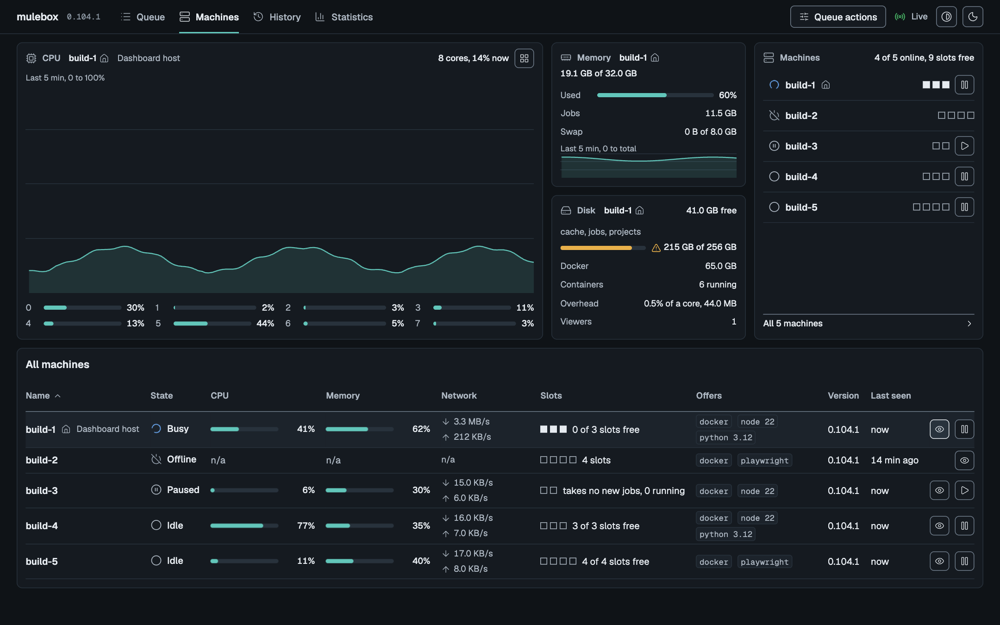 |
| A GitHub Actions run, step by step | Every machine at a glance |
| 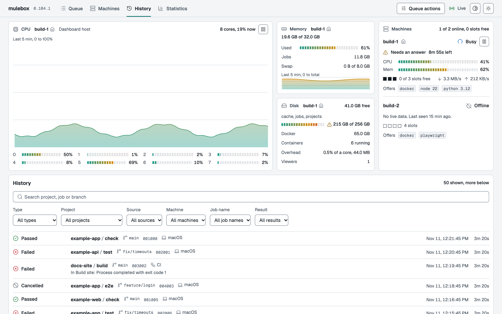 | 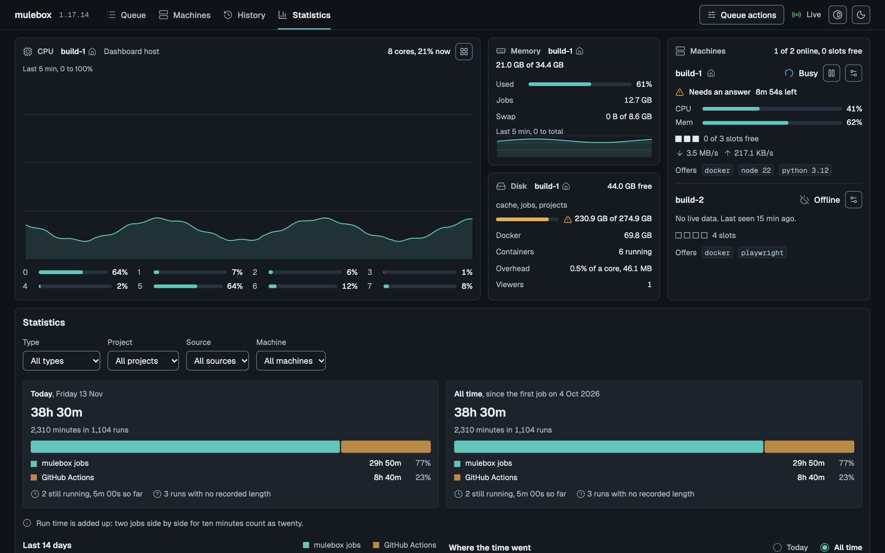 |
| History, searchable | Job minutes, by kind, project and machine |

A machine with many cores can show its busiest cores and one line for the rest (compact view,
left). On a phone the page stacks into one column (right).

<p>
  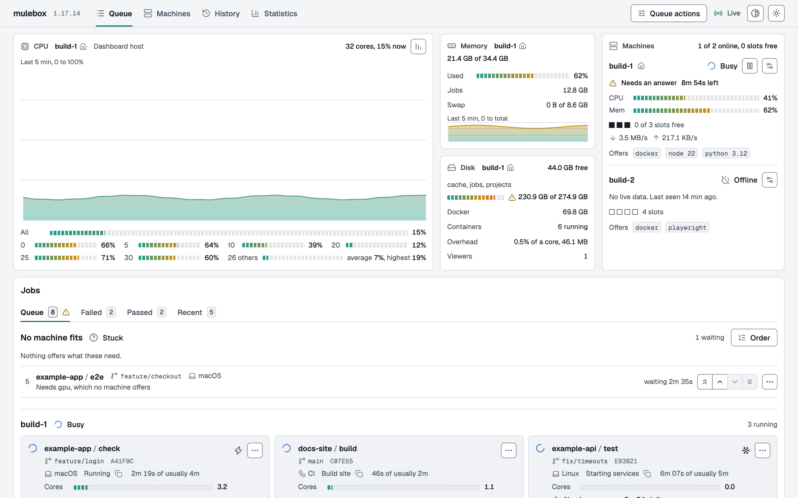
  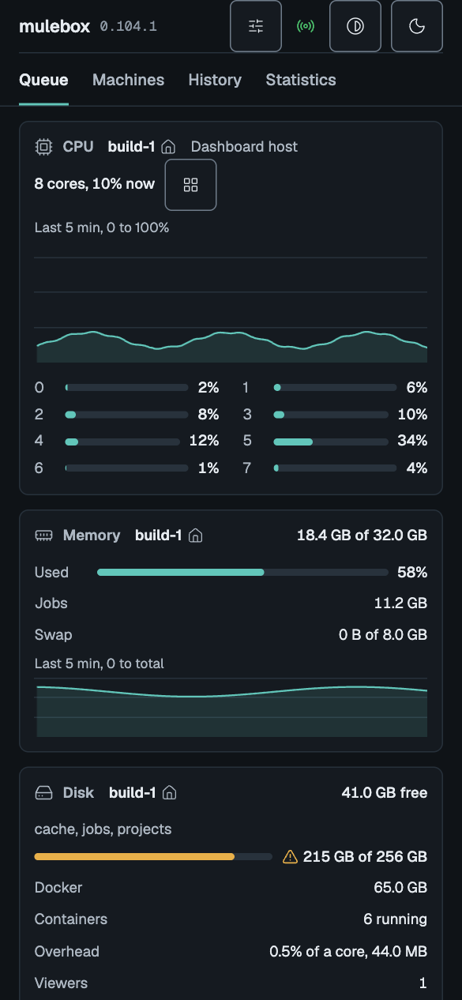
</p>

Every screen is built on one small design system, Gauge: its tokens, components and rules are in
[design-system.md](docs/design-system.md), with a reference page you can open in a browser
([specimen.html](docs/design-system/specimen.html)).

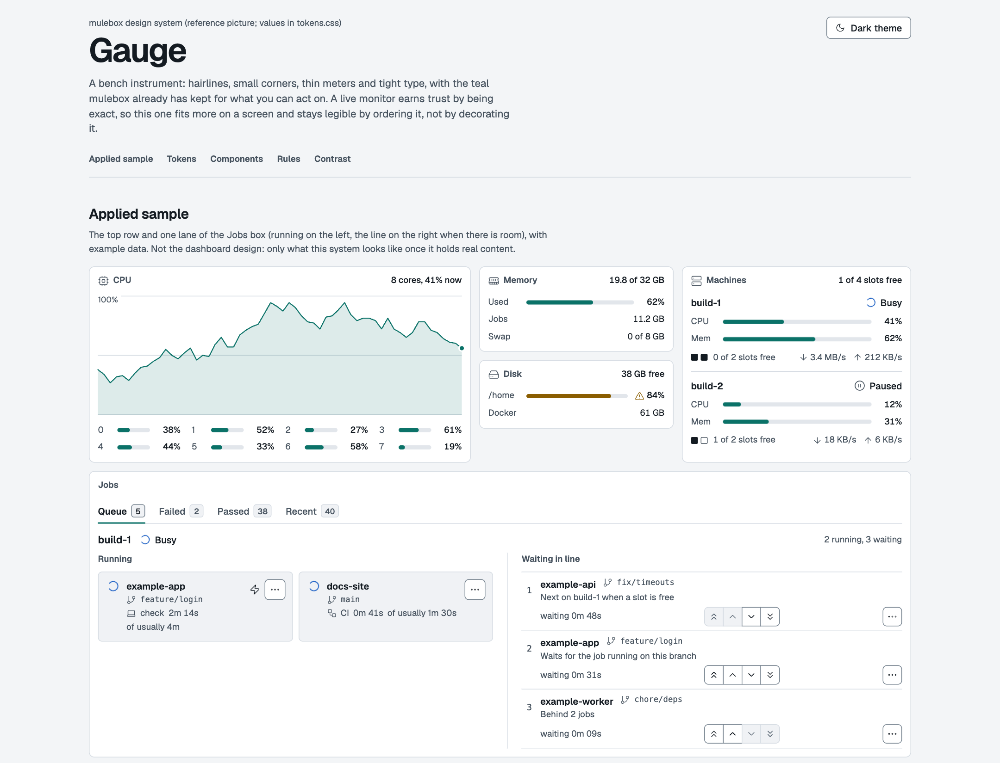

All pictures come from made-up data (`tools/screenshots.py`).

### Open it from your phone, with a password

By default the dashboard opens only through an ssh tunnel from the dev machine
(`mulebox dashboard open`), so it needs no password. To open it from any device on your network,
turn on `lan` mode on the coordinator node; the page then asks for a password:

<p>
  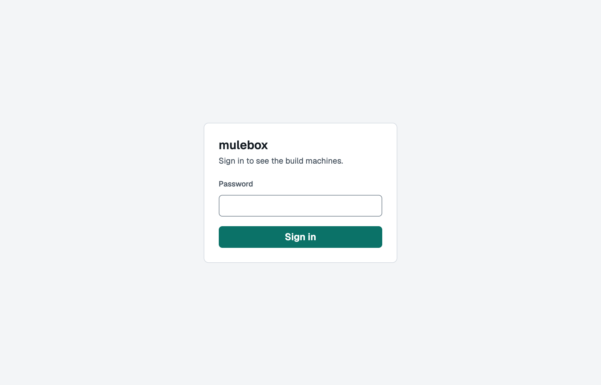
  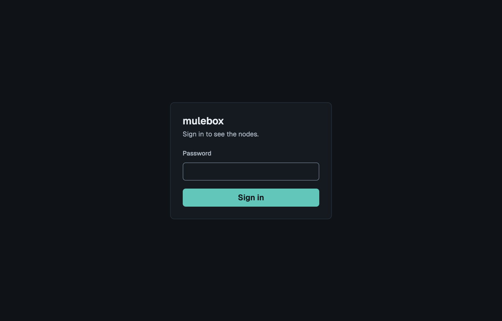
</p>

1. In `~/.config/mulebox/node.toml` on the node, under `[dashboard]`, set who may connect and the
   node's own address: `lan_range = "192.168.1.0/24"` and `lan_address = "192.168.1.50"`.
2. On the node: `mulebox dashboard password` (asks twice, at least 10 characters), then
   `mulebox dashboard firewall > firewall.sh`, read it, and `sudo sh firewall.sh`.
3. Set `mode = "lan"` under `[dashboard]` and `systemctl --user restart mulebox-dashboard`.
4. Open `http://192.168.1.50:8090` (the node's address) on any device in that range.

A sign-in lasts 24 hours; restarting the dashboard signs everyone out. It is plain HTTP unless you
turn on HTTPS, and a network you trust can go without the password (`lan_password = false`).
All of it, step by step: [Dashboard on the LAN](docs/install.md#dashboard-on-the-lan).

## Features

### For agents

- **One command, the same answer.** `mulebox check` runs the project's checks on a node and gives
  back the output and exit code a local run would, with your files as they are now, committed or
  not. If you change files while it runs, the result says it is stale.
- **Every job has an id.** Send it with `--detach`, keep working or end the session, and come back:
  `mulebox wait <id>` gives the output and exit code, `status <id>` where it stands, `logs <id>` its
  log. A job runs to its end even when its agent went away, and the agent's next command tells it the
  result, once.
- **Three ways to wait**: follow the job, be pinged when it ends (`mulebox events --job <id>`), or
  check back later.
- **No duplicate work.** On exactly the same files, `check` joins the job already running or gives its
  recent result, failures included. `--again` forces a run.
- **Failures read fast.** A failed job ends with a short summary of the error and the stage it failed
  in (`logs <id> --summary`), with a hint when the failure reads like a lost network.
- **Clear exit codes.** The check's own code on a failure; 5 for a job that could not start (a missing
  tool, an unreachable image, a bad lockfile); 2 for a config error, caught before anything is sent;
  75 for a job a restart interrupted; 76 for a stuck job that was stopped.
- **Long jobs ask, they do not die.** There is no hard time limit. A long job asks its agent if all is
  well, with its last output line; the agent answers `mulebox ok`. Only a job that is really stuck,
  with no answer, stops.
- **The position in line, and why.** A waiting job says where it stands, what runs ahead of it, and
  why it waits: its branch is busy, no machine has what it needs, a machine is paused.
- **Checked before anything is sent.** `mulebox doctor` checks the config, the node's tools and
  versions, the project's compose files and whether the node reaches the images' registries; it runs
  nothing.
- **Written for agents.** `mulebox contract` tells an agent how this project works through mulebox.
  The Claude Code skill teaches it the rest; `mulebox setup` installs it, and an agent whose skill is
  out of date is told so and updates it.
- **Problems reported safely.** `mulebox feedback draft` writes a GitHub issue with the job's ids,
  stages and log lines, scrubbed of addresses, names and secrets; `post` files it once you read it.

### Fast

- **Only changes cross the network.** Each project has a folder on the node, with a git worktree per
  branch, and a job sends only the files that changed since the last one.
- **Installs once.** `install` and `setup` run only when the lockfile, manifests or toolchain change,
  and a lost network during an install is tried again.
- **Download once, not every job.** Packages for pnpm, npm, Composer and pip are kept in a cache per
  project on the node, so the next job, a fresh container or the project's CI runner installs from
  there instead of the internet (`needs: [cache-pnpm]` in `.mulebox.yml`). On one real project, a
  second job reused all 73 packages and downloaded none; a Composer install ran with the network
  turned off.
- **Toolchains install themselves.** A project pins Node and pnpm, and the first job that needs a
  version installs it on the node, checked against the official checksums, once for every project.
- **Branches side by side.** Different branches run at once; a second job on the same branch waits.
- **Get ready ahead of time.** `mulebox warm` fetches toolchains, images and caches and runs the
  installs, with no command.
- **Quiet logs.** Image download progress is folded into one line, with the bytes on the stage.
- **How long it usually takes.** Each job and each stage shows its usual length from past passed
  runs, beside the time so far.

### Real projects

- **`mulebox init`** writes `.mulebox.yml` from the project's own files: Node, pnpm, npm, yarn, PHP with
  Composer, Python, Flutter, Go and Rust, also one folder down (`api/`, `web/`), following what the
  project's CI uses.
- **Docker Compose.** Every job gets its own containers, names, networks and host ports (a port in use
  moves), removed on every outcome, files written as root included. Services get 65536 open files and
  the machine's job settings.
- **Browser tests.** Playwright against the job's containers, with browsers kept for the next job.
- **Several jobs per project**, each with its own command, setup, ports and containers or none, and
  `env:` values that build on each other.
- **`mulebox run -- <cmd>`** runs any command on the node; `--in <service>` runs it in a compose
  service, `--take <path>` brings a changed file, such as a lockfile, back to the dev machine.

### GitHub Actions on the same machines

- **Runners for your private repositories** (`mulebox runner register --repo <owner>/<repo>`), with
  their own labels. A CI job waits for a slot in the same line as the agents, so the node never runs
  more than its slots.
- **CI runs in the dashboard**: each step live, its output as the runner writes it, its length and
  result; passed, failed or cancelled from the runner's own record, with the failed step and GitHub's
  message. A run's CPU counts its containers.
- **Steered like any job**: freeze, boost, move in line, open on GitHub, cancel on GitHub.
- **Shared caches**: a runner can download through the project's package caches (`runner caches`).
- **Private repositories only.** See below for why.

**Why not public repositories.** On a public repository anyone can fork it and open a pull request,
and GitHub runs the workflow file from that pull request, not yours. A stranger can write
`runs-on: [self-hosted, mulebox]` and a step such as `curl ... | sh`, and it runs on your build
machine as your user, with Docker (as good as root there), on your network, next to your other
projects' runners. GitHub's own documentation advises against self-hosted runners on public
repositories for this reason. Approving each outside contributor's run helps, but one careless
approval is enough, and the danger can hide in a changed test script rather than the workflow.
So `mulebox runner register` refuses a public repository, and a repository that turns public
later keeps its runner only until you unregister it. Open-source projects can use GitHub's own
hosted runners, which are free for public repositories; mulebox itself does.

### You steer

From the CLI or the dashboard, with no sign-in needed through the tunnel:

- **A job**: pause a waiting one (it keeps its place), freeze a running one with its containers and
  resume it where it stopped, boost it (the machine's CPU and disk first, nothing new starts beside
  it), move it to the front, up, down or to the end, cancel it.
- **A machine**: pause (drain) it so it finishes what runs and takes nothing new, resume it, or remove
  it.
- **A project**: pause all its jobs and CI runs, for a set time or until resumed (`mulebox project
  pause`).
- **Everything at once**: the dashboard's Queue actions pause or resume every machine, and freeze or
  resume every running job.
- **Upgrades in line**: `mulebox setup <node> --queued` waits its turn like a job, next by default or
  `--behind` the jobs already waiting, then installs and the line goes on. `--when-idle` waits for
  running jobs; a running job is never cut short unless you say `--now`.
- **Clean up**: `mulebox projects` shows each project's folder and size; `project clean` removes old
  branch folders, `project reset` a whole project. The node warns when its disk runs low.

### The dashboard

- **Live**: the line by machine, every running job with its stages as a waterfall and its log as it
  happens, and a note when a job is quiet but still working.
- **Top panels**: CPU over the last 5 minutes with a meter per core, or a compact view of the busiest
  cores; memory with what jobs use and swap; disk with Docker's share; network in and out; every
  machine with its slots and what it offers.
- **Tabs**: Queue, Failed, Passed and Recent, with live counts.
- **History** with search and filters you can share as a link, and **Statistics**: job minutes today,
  by day and since the first job, by kind, project, source and machine (also `mulebox stats`).
- **Machines page**: every node with its state, load, network, slots, version and last contact.
- **Out of step**: a strip says when a dev machine, a worker or a skill runs another version, with the fix.
- **Light and dark** themes and two meter styles, remembered per browser, and a layout that works on
  a phone.
- **From any device on your LAN**, with a password, a firewall rule and optional HTTPS, or read-only
  (`controls = false`).
- **Light on the node**: about 0.6% of one core and 46 MB with a page open.

### Machines and safety

- **One command to set up**: `mulebox setup <node>` installs a node from the dev machine, finds what it
  offers (Docker, Playwright, toolchains), writes the dev machine's config and proves it with a first job.
- **More nodes**: `mulebox setup <node> --worker-of <coordinator>` adds a worker, with a key that can
  only ask for work. Jobs go to a node that has what they need.
- **Survives restarts**: services come back by themselves after a reboot; a running job ends as
  `interrupted` (exit 75) and is not run again by itself, and waiting jobs run.
- **On your own machines**: jobs travel over ssh to machines you own; no cloud service, no port open
  to the internet.
- **Private by default**: files that look like secrets are never uploaded, and logs are scrubbed of
  secrets before they are stored or shown.
- **Stays in its folders**: mulebox writes and deletes only inside its own roots on a node, checked
  for links and mounts. Jobs run under systemd with limits, and nothing is left behind.
- **Old logs go by themselves** after 30 days; job records stay.

## Commands

Every command has its own help: `mulebox --help` lists them, `mulebox <command> --help` explains
one. `<node>` is a node's ssh name, `<id>` a job's id, which every job gets and every
command prints. The ones you and your agents use:

**Run jobs**, from a project folder:

| Command | What it does |
| --- | --- |
| `mulebox init` | write `.mulebox.yml` from the project's own files |
| `mulebox check [job]` | run a job from `.mulebox.yml` (default `check`) on a node; exits with its exit code. `--detach` returns at once with the id, `--again` runs even on files already tested |
| `mulebox run -- <cmd>` | run any command there, once; `--in <service>` runs it in a compose service |
| `mulebox warm` | get toolchains, images, caches and installs ready ahead of a job |
| `mulebox doctor` | check the project and the node before sending anything; changes nothing |
| `mulebox contract` | how this project works through mulebox, written for agents |

**Follow jobs**:

| Command | What it does |
| --- | --- |
| `mulebox queue` | what is running, waiting and recently finished, and why a job waits |
| `mulebox status <id>` | one job's state, stage, last line and usual length |
| `mulebox wait <id>` | wait for a job and end with its result and exit code, as `check` would |
| `mulebox events --job <id>` | a job's changes of state as lines, for agents that want to be pinged |
| `mulebox logs <id>` | a job's log; `--summary` gives only the failure summary |
| `mulebox ok <id>` | answer a long job's question: all is well, let it go on |
| `mulebox projects` | every project that has run, with its folder and size on the node |
| `mulebox stats` | how long jobs ran, today, by day and in total |

**Steer the line**:

| Command | What it does |
| --- | --- |
| `mulebox cancel <id>` | cancel a job |
| `mulebox pause <id>`, `resume <id>` | hold a waiting job, or freeze a running one, and let it go again |
| `mulebox first`, `up`, `down`, `last <id>` | move a waiting job in line |
| `mulebox boost <id>`, `normal <id>` | give a job the machine first, and end that |
| `mulebox project pause`, `resume`, `paused` | hold all of a project's jobs and CI runs for a while |
| `mulebox project clean`, `reset` | remove old branch folders, or a project's whole folder, on the node |

**Machines and setup**:

| Command | What it does |
| --- | --- |
| `mulebox setup <node>` | install or upgrade mulebox on a node from the dev machine; `--queued` waits its turn in line, `--worker-of <coordinator>` adds a worker |
| `mulebox machine list`, `drain`, `resume`, `remove` | every node, online or not; stop one taking jobs, bring it back, forget it |
| `mulebox dashboard open` | the dashboard in your browser, through an ssh tunnel |
| `mulebox dashboard password`, `firewall`, `cert` | on the node: sign-in, firewall and HTTPS for `lan` mode |
| `mulebox runner register`, `unregister` | add or remove a GitHub Actions runner for a private repository |
| `mulebox skill install`, `update`, `status` | the agent skill in your Claude config folders |
| `mulebox feedback draft`, `post` | report a problem as a GitHub issue, scrubbed of private data first |
| `mulebox version` | this mulebox's version |

The rest of `mulebox --help` (`rpc`, `worker`, `coordinator`, `runner-hook` and others) is what
mulebox runs on the nodes itself; you do not call those.

## Documentation

| Page | For |
| --- | --- |
| [getting-started.md](docs/getting-started.md) | the first install and the first project, in order |
| [install.md](docs/install.md) | node, dev machine, upgrades, more nodes, GitHub runners, the dashboard |
| [agents.md](docs/agents.md) | everyday commands, every `.mulebox.yml` field, the agent rule |
| [troubleshooting.md](docs/troubleshooting.md) | what an error means and what to do |
| [design.md](docs/design.md) | how it works and why |
| [design-system.md](docs/design-system.md) | the dashboard's look: tokens, components, rules |
| [phases.md](docs/phases.md) | the roadmap: what is done and what is open |
| [releasing.md](docs/releasing.md) | CI and releases, for maintainers |

## For coding agents

mulebox ships a skill for Claude Code, [SKILL.md](mulebox/client/skill/SKILL.md), that teaches an
agent to send its work through mulebox in any project. You do not install it yourself:

```sh
mulebox setup <node>           # installs the skill in every Claude config folder, updates old copies
mulebox skill status           # which copies you have, and whether they match this mulebox
mulebox skill update           # bring them up to date by hand
```

The skill is part of mulebox, so the newest skill comes with the newest mulebox:
`uv tool upgrade mulebox` (or `pipx upgrade mulebox`), then `mulebox setup <node>` upgrades the
node and the skill together. An
agent whose skill is out of date is told so by mulebox itself and updates it. Details:
[install.md](docs/install.md#skill-for-coding-agents).

Agents without skills can read [docs/agents.md](docs/agents.md): everyday use, setting a project
up (`.mulebox.yml`, the agent rule), and moving GitHub Actions to mulebox runners. Point an agent
at it: "read mulebox's docs/agents.md and set this project up".

## Security

mulebox is for one owner and the projects that owner trusts. A job runs as the node's user, with
Docker, so it is not a sandbox: read the [security model](docs/install.md#security-model) before
pointing it at a machine that holds anything else. mulebox attaches GitHub runners to private
repositories only ([why](#github-actions-on-the-same-machines)).

## Development

Requires Python 3.12 or newer, and Node.js 22 with npm for the dashboard's front end (`web/`,
[web/README.md](web/README.md)): from a checkout, `mulebox setup` builds it and stops without npm,
and the dashboard shows no page until it is built.

```sh
python3 -m venv .venv
.venv/bin/python -m pip install -e '.[dev]'
.venv/bin/mulebox --version
.venv/bin/python -m pytest              # includes the file-size check
.venv/bin/python -m pytest -n auto      # same, in parallel (about 5x faster)
.venv/bin/python tools/check_line_counts.py
(cd web && npm ci && npm run build)    # the dashboard's page, into mulebox/dashboard/app/
.venv/bin/python tools/screenshots.py   # the README's pictures, from the dashboard's stand-in data
```

After a VERSION bump, rerun the `pip install -e` step: the installed metadata keeps the old
version until then and the version test fails.

CI and the release process: [docs/releasing.md](docs/releasing.md). Rules for contributors and
agents: [AGENTS.md](AGENTS.md). Every change bumps [VERSION](VERSION) and adds an entry to
[PROJECT_LOG.md](PROJECT_LOG.md).

## License

[MIT](LICENSE).
